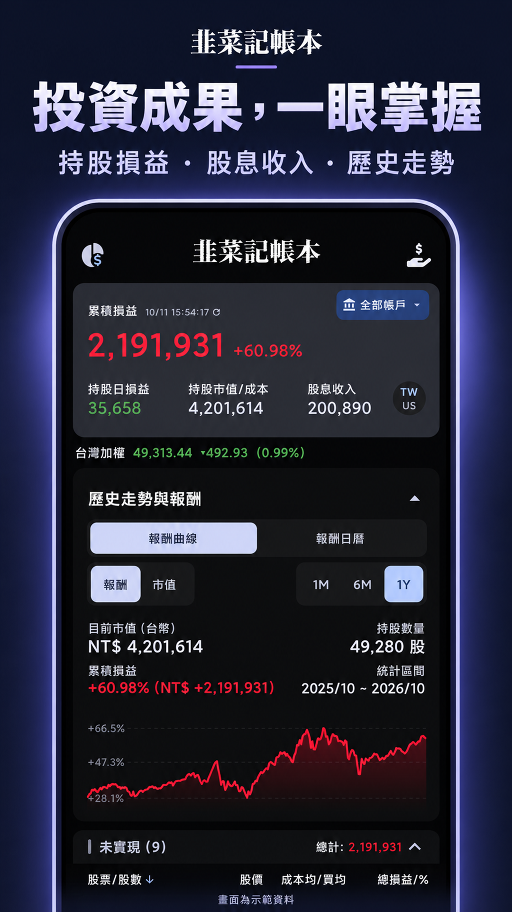
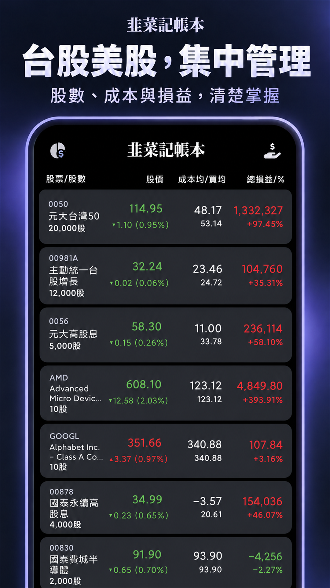
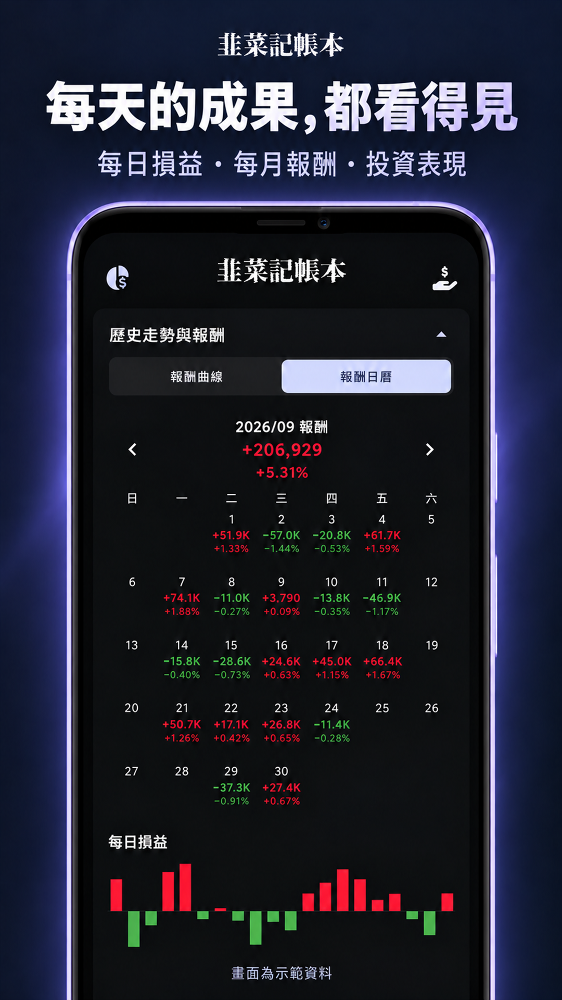
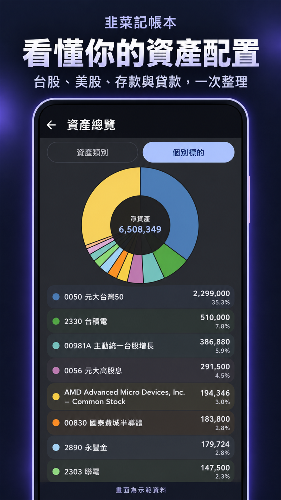
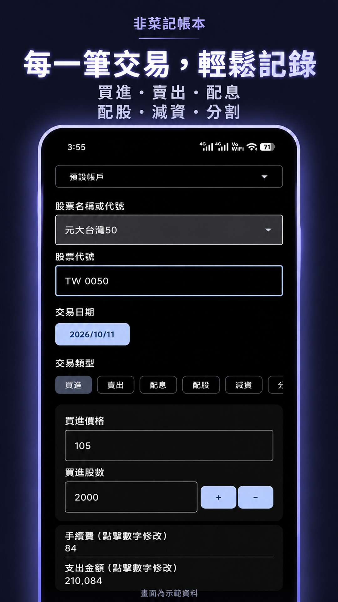
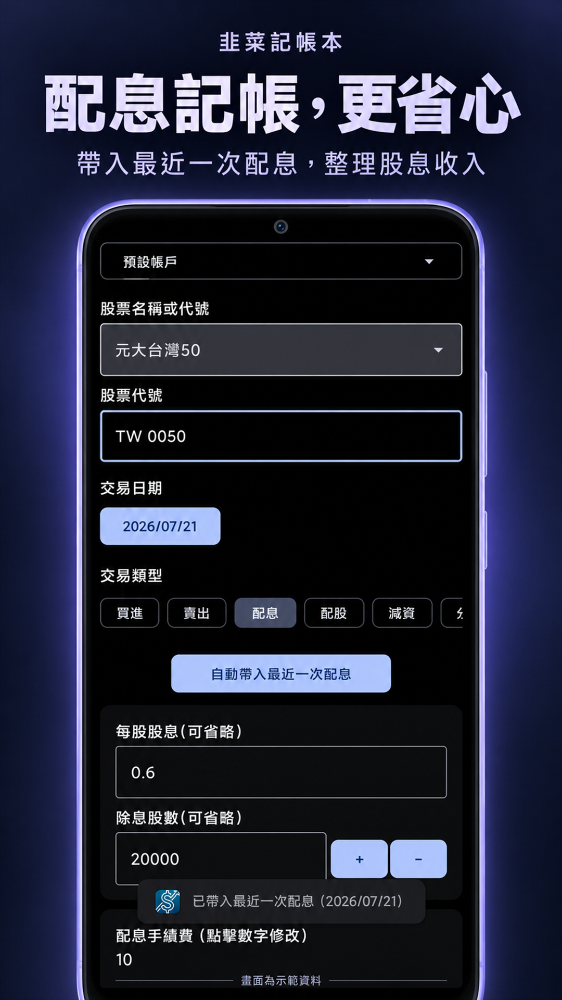
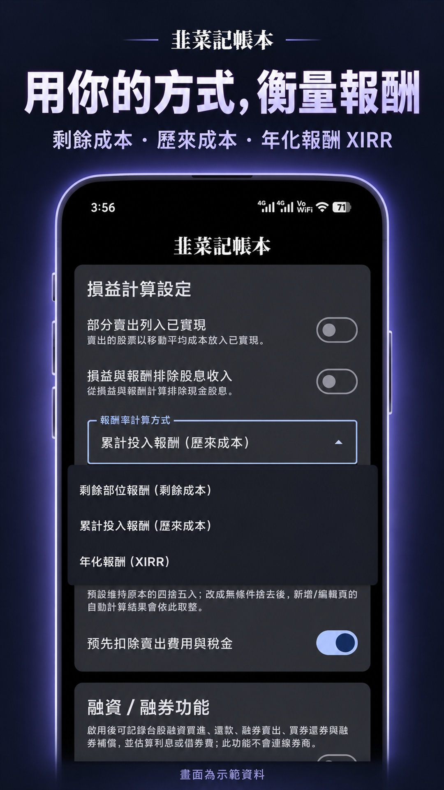
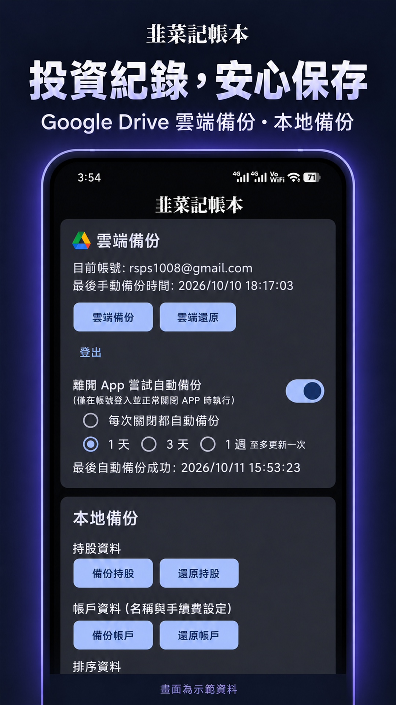

# 韭菜記帳本（Stockify）

**持股、損益與資產，一眼掌握。**

韭菜記帳本是一款開源、免費的 Android 股票交易記帳與持股管理 App。集中管理台股、美股與多個證券帳戶，從日常買賣、股息收入到長期報酬，把分散的投資資料整理成清楚的成果。

[Google Play 下載](https://play.google.com/store/apps/details?id=com.rsps1008.stockify) · [官方網站](https://stockify.rsps1008.ru/) · [隱私權政策](https://stockify.rsps1008.ru/privacy-policy/)

## 前言

這是一個為了紀念與取代舊版 `com.bigmiracle.stockify` 而生的專案。

過去，`com.bigmiracle.stockify` 是一款出色的免費股票記帳軟體，許多人都曾依賴它來管理自己的投資。然而，最近它不僅開始收費，還導入了 Play Integrity 機制，使得在電腦模擬器上使用的用戶無法繼續順利記帳。

為了重現那段美好的免費使用時光，並確保投資管理者在任何裝置上都能自由操作，我借助 Vibe-Coding 的力量，從頭打造了這個全新的韭菜記帳本。它開源、免費，且永遠歡迎社群共同改進。

## 功能亮點

### 集保 E 存摺匯入，快速開始

將「集保 E 存摺」匯出的庫存 PDF 匯入，輸入密碼並預覽確認後，即可建立持股清單，省去逐檔輸入股票與股數的時間。App 內提供 PDF 匯出教學，並支援新增或替代匯入。

匯入時以目前取得的股價建立買進快照，手續費為零；這是建立持股的起點，不會還原原始買進成本或歷史交易。

### 台股、美股與交易，集中整理

整合多個證券帳戶，切換台股、美股或合併檢視。買進、賣出、配息、配股，以及分割、減資等公司行動，都能保留完整紀錄，並支援交易備註。台股另提供融資融券記帳與利息估算。

搭配即時報價，自動計算持股成本、市值與已實現、未實現損益。合併檢視將美股金額依 USD/TWD 匯率換算為台幣，個股仍維持原始幣別；持股清單可依欄位排序，或在未套用欄位排序時長按拖曳。

### 投資表現，不只看當下

透過歷史損益曲線追蹤長期變化，再用報酬日曆回顧每日與每月成果。提供剩餘部位成本、歷來投入成本與年化報酬率（XIRR）三種計算方式，也可選擇將部分賣出列入已實現，或從損益與報酬中排除股息收入。

配息記帳可帶入最近一次配息資料，方便整理股息收入；首頁亦提供台灣加權指數摘要，個股頁可快速查看 Yahoo Finance。

### 從持股配置，看到整體資產

以圓餅圖查看台股、美股與個別持股的配置比例，點擊切片或圖例即可查看標的。加入銀行存款與貸款後，將股票以外的資產及負債一起納入，掌握整體淨資產。

### 投資紀錄，長期安心保存

支援 CSV 匯入匯出、本機及 Google Drive 備份還原，方便保存資料或換機接續記帳。持股雲端備份包含交易、證券帳戶與持股排序，也可啟用離開 App 後的自動雲端備份。

銀行存款與貸款提供獨立的本機與 Google Drive 備份／還原，不混入持股交易 CSV 或持股雲端備份。

### 依自己的習慣使用

可調整主題與文字大小，並設定數字密碼鎖及生物辨識快速解鎖。主要資料保存在裝置本機，是否使用 App 內的 Google Drive 備份由您決定；Android 系統備份與裝置移轉則依系統設定運作。

## 功能截圖

以下使用 Google Play 截圖定稿，畫面中的投資數據為示範資料。

| 持股損益 | 台美股管理 | 報酬日曆 | 資產總覽 |
| :---: | :---: | :---: | :---: |
|  |  |  |  |

| 交易記帳 | 配息紀錄 | 報酬率設定 | 備份還原 |
| :---: | :---: | :---: | :---: |
|  |  |  |  |

## 資料與使用說明

- 台股報價使用 TWSE／Yahoo，美股使用 Nasdaq／Yahoo；依市場時區、交易時段與休市日曆更新，手動刷新可在休市時執行。
- 台股清單來自 TWSE，美股清單來自 Nasdaq Trader。啟動時依更新期限檢查，也可在設定中手動更新，無需額外提供 API key。
- 歷史圖表依交易時序處理分割、減資與股利，是否納入今天依市場當地收盤時間決定；報酬日曆沿用相同歷史計算結果。
- 融資融券屬本地記帳估算；行情與分析用於整理投資紀錄，並非券商對帳資料或投資建議。
- App 鎖不代表本機資料庫或匯出備份已加密，請妥善保管裝置與備份檔案。

## 技術架構

- **語言與 UI：** Kotlin、Jetpack Compose、Material 3
- **架構：** MVVM，依 `data/`、`ui/viewmodel/`、`ui/screens/` 分層
- **本地資料：** Room 儲存股票、證券帳戶、交易與歷史價格；DataStore 儲存偏好、快取、排序、存款與貸款
- **網路：** Ktor HTTP Client、Jsoup；行情與歷史資料使用 TWSE、TPEx、Yahoo Finance 與 Nasdaq，股票清單另使用 Nasdaq Trader
- **備份與排程：** Google Identity 授權、Google Drive API、WorkManager
- **PDF：** PDFBox Android，用於集保 E 存摺 PDF 解密與文字抽取
- **Android：** 最低 API 26，`compileSdk`／`targetSdk` 37
- **目前專案版本：** 1.7.2（versionCode 1721），以 `app/build.gradle.kts` 為準

## 編譯與執行

需求：Android Studio、JDK 21、Android SDK API 37。依賴版本以 `gradle/libs.versions.toml` 與 Gradle wrapper 為準。

Windows PowerShell：

```powershell
./gradlew.bat compileDebugKotlin
./gradlew.bat test
./gradlew.bat assembleDebug
./gradlew.bat installDebug
```

`installDebug` 需要已連線的 Android 裝置或模擬器。編譯與單元測試不等同於實機功能驗證。

## 授權與隱私

本專案採用 [MIT License](./LICENSE)。使用、複製、修改、合併、發布與散布衍生作品時，請保留原始版權與授權聲明。

資料處理方式請參閱[隱私權政策](https://stockify.rsps1008.ru/privacy-policy/)，使用規範請參閱[公開服務條款](https://stockify.rsps1008.ru/terms-of-service/)。

本專案源自希望延續免費股票記帳工具的想法，歡迎提出 Issue 或 Pull Request 一起改進。
